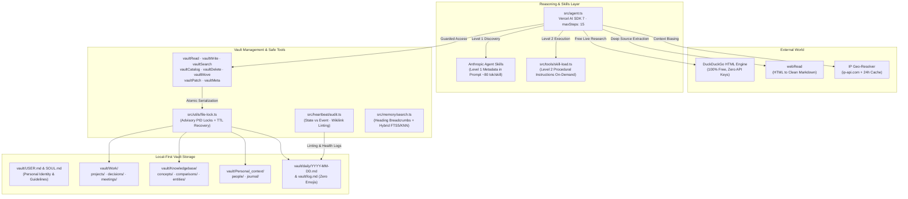

# AI Second Brain — Current State & Architecture Specification

> **Document Version:** 2.0.0  
> **Timestamp:** October 11, 2026  
> **Baseline Commit:** `5289435` ("Complete phases 1, 2, 3, 5, 6, 8, 10")  
> **Current Status:** 72/72 Unit Tests Passing (6 Suites) · 0 TypeScript Errors (`tsc --noEmit`)

---

## 1. Executive Summary & Strategic Context

This document captures the end-to-end state of the `ai_brain` repository following the major strategic overhaul initiated after the Sunday 9:30 PM architecture review with Prakash uncle.

### Core Strategic Mandates
1. **Reduce Cognitive Load**: The system must autonomously organize messy inputs, perform multi-step due diligence, and eliminate context rot without requiring manual maintenance.
2. **Local-First, Privacy-Sovereign Benchmark (Muse by Meta AI Alternative)**: Deliver agentic, multi-step problem solving without trapping personal data in proprietary walled gardens.
3. **Data Security & Integrity**: Cross-process file locks, immutable audit logs, path sanitization, and strict separation between mutable state facts and immutable historical events.
4. **General Capabilities Tied to User Context**: Zero hardcoded domain rules. All checklists, inspection criteria, and research steps are dynamically synthesized by the agent using the user's private vault context (`USER.md`, `SOUL.md`) combined with live web intelligence.
5. **Strict Epistemic Isolation**: Web search results live exclusively in conversation working memory for synthesis; raw web scrapes are never dumped into the vault.
6. **Zero `MEMORY.md` Dumping**: Permanent synthesized notes are routed to structured directories (`Work/decisions/`, `Work/projects/`, `Knowledgebase/concepts/`), keeping `MEMORY.md` reserved strictly for high-level durable identity (<1,000 bytes).

---

## 2. Comprehensive System Architecture



---

## 3. Deep Inventory of All Changes Since Commit `5289435`

### Pillar 1: Vault Management & Security Infrastructure

#### 1. Cross-Process Atomic File Locking (`src/utils/file-lock.ts`)
* **Problem Solved:** Concurrent background heartbeat runs, CLI interactions, and Web UI requests previously wrote to markdown files simultaneously, risking silent data corruption.
* **Implementation:**
  - File-level locking via lockfiles with PID tracking and timestamps.
  - Stale lock detection: automatically recovers locks abandoned by killed processes or expired TTLs (default 10s).
  - Directory write semaphore (`withVaultLock`): serializes vault-wide batch operations like ingestion and audits.
* **Test Coverage:** Verified in `src/utils/file-lock.test.ts` (concurrent collision avoidance, recovery from stale PIDs).

#### 2. Second Brain Audit Engine (`src/heartbeat/audit.ts`)
* **Problem Solved:** Over time, second brain notes suffer from "context rot" because agents append new lines rather than replacing outdated state facts.
* **Methodology (Cole Medin Standard):**
  - **State vs. Event Separation**: Distinguishes mutable State facts (budgets, roles, active projects) from immutable Event facts (meeting minutes, log lines, completed milestones).
  - **Audit Surfaces**:
    - Surface 1: Scans `SOUL.md`, `USER.md`, and `MEMORY.md`, comparing active claims against recent daily logs and event streams.
    - Surface 2: Detects broken `[[wikilinks]]` pointing to missing notes.
    - Surface 3: Detects orphan notes lacking inbound or outbound graph connections.
  - **Clean Output Protocol**: Strictly zero emojis in `vault/log.md` and terminal reports.
* **Test Coverage:** Verified in `src/heartbeat/audit.test.ts`.

#### 3. Complete Vault CRUD & Management Tools
* **`src/tools/vault-delete.ts`**: Safely deletes vault notes while strictly protecting core identity files (`SOUL.md`, `USER.md`, `MEMORY.md`, `BOOTSTRAP.md`, `index.md`, `log.md`).
* **`src/tools/vault-move.ts`**: Moves and renames files within the vault, verifying target paths and updating links.
* **`src/tools/vault-patch.ts`**: Executes targeted search-and-replace patches within files, avoiding the need for the LLM to rewrite entire large documents.
* **`src/tools/vault-meta.ts`**: Parses and updates structured YAML frontmatter fields (`gray-matter`) safely.
* **Test Coverage:** Verified in `src/tools/vault-tools.test.ts`.

#### 4. Semantic Markdown Chunking & Search (`src/memory/search.ts`)
* **Problem Solved:** Character-based chunking previously severed tables and lists mid-sentence.
* **Implementation:**
  - Splits at semantic Markdown boundaries first (`#`, `##`, `###`, `---`, double newlines).
  - Injects contextual heading breadcrumbs (`[Context: Document Title > Section > Subheading]`) into each chunk before embedding, ensuring vector retrieval preserves hierarchy.
* **Test Coverage:** Verified in `src/memory/search.test.ts`.

---

### Pillar 2: 100% Free Web Tools & Epistemic Isolation

#### 1. Free DuckDuckGo HTML Engine (`src/tools/web-search.ts`)
* **Zero API Keys**: Directly queries the DuckDuckGo HTML endpoint (`https://html.duckduckgo.com/html/?q=...`) using standard Node.js fetch with browser headers.
* **Clean Link Decoding**: Decodes target URLs from DuckDuckGo redirect strings (`//duckduckgo.com/l/?uddg=<url>`).
* **Instant Answer API Fallback**: Queries `api.duckduckgo.com` if HTML returns zero organic snippets.
* **Epistemic Boundary**: Raw search blobs live in working memory ONLY and are never written to the vault.

#### 2. Web Content Reader (`src/tools/web-read.ts`)
* **Implementation**: Uses `html-to-text` with custom selectors to strip navigation, ads, headers, scripts, and styling.
* **Configurable Truncation**: Enforces a strict character ceiling (default 8,000 chars) to prevent context explosion.

#### 3. Automatic Location Context (`src/utils/location.ts`)
* **Zero Config**: Resolves client/server IP location via free `http://ip-api.com/json`.
* **24-Hour Cache**: Stores coordinates, city, and country in `state/location.json` to prevent network spam.
* **Timezone Fallback**: Falls back gracefully to `Intl.DateTimeFormat().resolvedOptions().timeZone` if offline.

---

### Pillar 3: Anthropic Agent Skills Standard Runtime

Instead of hardcoding brittle TypeScript logic, skills are **filesystem-based modular resources** adhering to the official Anthropic Agent Skills specification.

#### 1. Three-Tier Progressive Disclosure (`src/skills/loader.ts`)
* **Level 1 (Metadata Index in Prompt)**:
  Scanned on boot from `skills/*/SKILL.md` frontmatter. Only `name`, `path`, and trigger `description` (~80 tokens per skill) are injected into the system prompt inside an `<available_skills>` block.
* **Level 2 (Procedural Instructions On-Demand)**:
  When a user prompt matches a skill description, the agent calls `skillLoad({ skillName: "..." })` to load the full procedural markdown into conversation memory.
* **Level 3 (Domain References)**:
  Deep checklists or scripts in `skills/<skill-name>/references/` loaded on demand.

#### 2. The 8 Universal Agent Skills Built (`skills/`)
1. **`skills/high-stakes-decision-advisor/SKILL.md`**:
   - Evaluates major life/financial commitments (vehicles, equipment, real estate, job offers, insurance).
   - Dynamically generates custom due-diligence criteria, negotiation levers, and inspection checklists.
   - Archives structured decision records in `Work/decisions/YYYY-MM-DD_<topic>_evaluation.md`.
2. **`skills/deep-research-synthesizer/SKILL.md`**:
   - Researches unfamiliar topics, mental models, and competing frameworks across multi-angle web queries.
   - Distills evergreen concepts and writes encyclopedia notes with `[[wikilinks]]` to `Knowledgebase/concepts/`.
3. **`skills/meeting-prep-and-debrief/SKILL.md`**:
   - Mode A (Prep): Gathers attendee CRM history from `Personal_context/people/` and active project status; generates talking points and tactical questions in `Work/meetings/`.
   - Mode B (Debrief): Extracts decisions, action item checklists, and updates mutable project state.
4. **`skills/daily-briefing-and-planner/SKILL.md`**:
   - Morning/evening cognitive offloader; deconflicts priorities from `Work/projects/` and `Inbox/`.
   - Structures deep-work focus blocks and writes today's log in `vault/daily/YYYY-MM-DD.md`.
5. **`skills/second-brain-audit/SKILL.md`**:
   - Eliminates context rot; enforces State vs. Event separation; repairs broken wikilinks and orphan notes; clean zero-emoji logging to `vault/log.md`.
6. **`skills/raw-dump-organizer/SKILL.md`**:
   - Deconstructs chaotic voice memos, clippings, and brain dumps into discrete topics.
   - Routes pieces to `Work/`, `Knowledgebase/`, and `Personal_context/`, maintaining graph connectivity.
7. **`skills/contract-and-document-analyzer/SKILL.md`**:
   - Evaluates contracts, agreements, NDAs, and insurance policies for asymmetric liabilities and hidden fees.
   - Dynamically compiles a Red/Yellow/Green clause risk matrix and redlines in `Work/decisions/`.
8. **`skills/project-breakdown-and-tracking/SKILL.md`**:
   - Decomposes complex goals into sequential milestones, dependency maps, task checklists `[ ]`, and risk mitigations in `Work/projects/`.

---

## 4. File-by-File Modification Summary

| File | Nature of Change | Description |
|---|---|---|
| `package.json` | Modified | Added test suites (`loader.test.ts`, `web-tools.test.ts`, `audit.test.ts`, `file-lock.test.ts`) |
| `src/agent.ts` | Modified | Integrated `skillLoad`, injected `<available_skills>` prompt block, bumped `maxSteps: 15` |
| `src/tools/index.ts` | Modified | Exported `webSearch`, `webRead`, `skillLoad`, `vaultDelete`, `vaultMove`, `vaultPatch`, `vaultMeta` |
| `src/tools/skill-load.ts` | **New** | Tool to dynamically load Level 2 skill instructions & Level 3 references |
| `src/tools/web-search.ts` | **New** | 100% free DuckDuckGo HTML search tool with location biasing |
| `src/tools/web-read.ts` | **New** | Clean HTML-to-markdown reader using `html-to-text` |
| `src/tools/vault-delete.ts` | **New** | Safe file deletion with protected core identity files |
| `src/tools/vault-move.ts` | **New** | Safe file move and rename within vault |
| `src/tools/vault-patch.ts` | **New** | Precise find-and-replace text patching |
| `src/tools/vault-meta.ts` | **New** | Frontmatter YAML reading and updating |
| `src/utils/file-lock.ts` | **New** | Cross-process advisory lockfile engine with stale PID recovery |
| `src/utils/location.ts` | **New** | Free IP geolocation resolver with 24-hour file cache |
| `src/skills/loader.ts` | **New** | Anthropic Agent Skills standard filesystem discovery & loader |
| `src/skills/loader.test.ts` | **New** | Unit tests for skill discovery, prompt formatting, traversal defense |
| `src/heartbeat/audit.ts` | **New** | Cole Medin weekly second brain audit engine (zero emojis) |
| `skills/*` (8 directories) | **New** | The 8 universal cognitive skill definitions (`SKILL.md`) |

---

## 5. Verification & Test Metrics

```text
> npm test

ℹ tests 72
ℹ suites 6
ℹ pass 72
ℹ fail 0
ℹ cancelled 0
ℹ skipped 0
ℹ todo 0
ℹ duration_ms 7810.557037

> npm run typecheck
> tsc --noEmit
(Exited with status 0, zero errors)
```

---

## 6. Next Phase Roadmap (Phase 2C & Pillar 3)

1. **Reasoning Layer on Vercel AI SDK (Phase 2C)**:
   - Hook into Vercel AI SDK 7's native `prepareStep` to implement **Progressive Summarization** and the **Memory Pointer Pattern** (offloading intermediate payloads >2,500 chars to `state/scratch/` pointers).
   - Purge hardcoded keywords from `web-search.ts` and dynamic timezone reading from `USER.md`.
2. **Security & Trust Layer (Pillar 3)**:
   - Prompt injection defense for scraped web pages and inbox dumps.
   - Secret redaction for credentials, API keys, and sensitive tokens.
   - Soft trash retention (`vault/Archive/.trash/`) enabling `/rollback`.
3. **User Interfaces**:
   - `/skills` CLI command in `src/cli.ts`.
   - Dedicated Skills Explorer panel in `ui/`.
